# Réseau d'entreprise sous Cisco Packet Tracer

VLAN, routage inter-VLAN, DHCP, DNS/HTTP, NAT/PAT et ACL : simulation du réseau d'une petite entreprise de trois services (Comptabilité, Informatique, Direction), avec accès à Internet simulé.

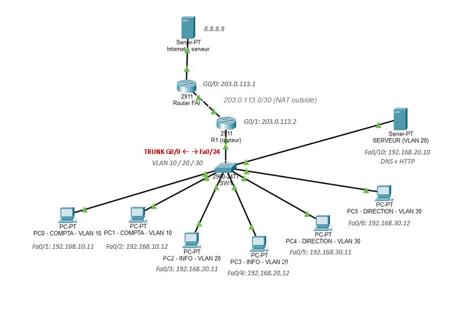

## Objectif

Construire un réseau d'entreprise segmenté par VLAN, où :

- les services sont isolés dans des réseaux distincts (VLAN 10, 20 et 30) ;
- un routeur assure la communication entre les VLAN (router-on-a-stick) ;
- les postes reçoivent leur adresse automatiquement (DHCP) ;
- un serveur interne fournit un site web et la résolution de noms (HTTP et DNS) ;
- les postes accèdent à Internet via le NAT/PAT ;
- une ACL interdit à la Comptabilité d'accéder à la Direction.

## Matériel simulé

| Rôle | Modèle (Packet Tracer) | Quantité |
|---|---|---|
| Switch SW1 | Cisco 2960-24TT | 1 |
| Routeur R1 (passerelle de l'entreprise) | Cisco 2911 | 1 |
| Routeur FAI (fournisseur d'accès) | Cisco 2911 | 1 |
| Serveur interne (DNS + HTTP) | Server-PT | 1 |
| Serveur Internet (8.8.8.8) | Server-PT | 1 |
| Postes de travail | PC-PT | 6 |

## Plan d'adressage

| Service | VLAN | Réseau | Passerelle | Ports du switch |
|---|---|---|---|---|
| Comptabilité | 10 | 192.168.10.0/24 | 192.168.10.1 | Fa0/1 à Fa0/2 |
| Informatique | 20 | 192.168.20.0/24 | 192.168.20.1 | Fa0/3 à Fa0/4 |
| Direction | 30 | 192.168.30.0/24 | 192.168.30.1 | Fa0/5 à Fa0/6 |
| Serveur interne | 20 | 192.168.20.10 | 192.168.20.1 | Fa0/10 |
| Liaison FAI | - | 203.0.113.0/30 | R1 .2 / FAI .1 | R1 G0/1 |

Le lien SW1 (Fa0/24) - R1 (G0/0) est un **trunk 802.1Q** qui transporte les trois VLAN. Le serveur Internet (8.8.8.8/24, passerelle 8.8.8.1) est relié au port G0/1 du routeur FAI.

## Configuration

Les configurations complètes, prêtes à coller dans le CLI, sont dans le dossier [`configs/`](configs/) :

- [`SW1.txt`](configs/SW1.txt) : VLAN, ports d'accès et trunk
- [`R1.txt`](configs/R1.txt) : sous-interfaces inter-VLAN, DHCP, NAT/PAT, ACL
- [`FAI.txt`](configs/FAI.txt) : routeur du fournisseur d'accès

### 1. Switch : VLAN, ports d'accès et trunk

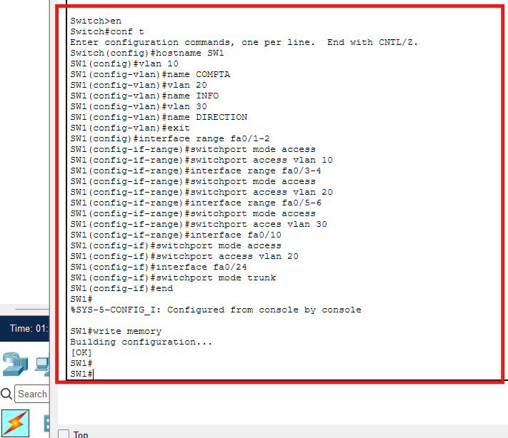

### 2. Routeur R1 : routage inter-VLAN (router-on-a-stick)

Une sous-interface par VLAN, avec encapsulation 802.1Q.

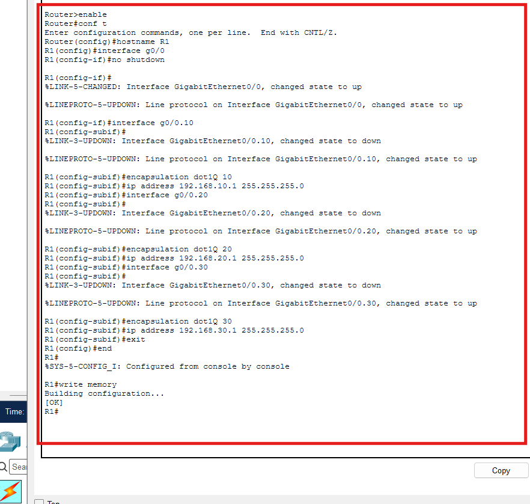

### 3. DHCP : un pool par VLAN

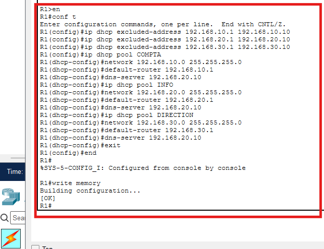

### 4. Serveur interne : HTTP et DNS

- IP `192.168.20.10`, masque `255.255.255.0`, passerelle `192.168.20.1`
- Service HTTP activé, page `index.html` personnalisée
- Service DNS activé, enregistrement `entreprise.local` (type A) vers `192.168.20.10`


### 5. Internet simulé et NAT/PAT

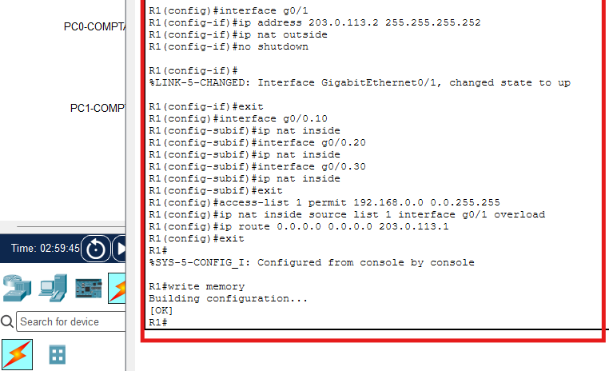

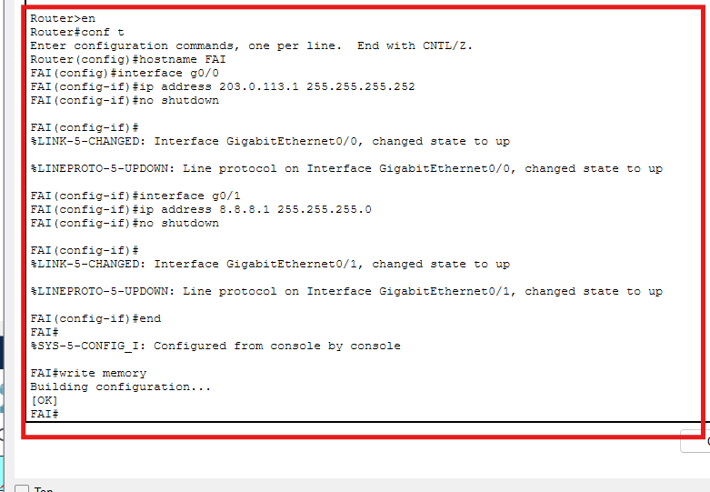

### 6. ACL : la Comptabilité ne peut pas atteindre la Direction

```
ip access-list extended COMPTA_IN
 deny ip 192.168.10.0 0.0.0.255 192.168.30.0 0.0.0.255
 permit ip any any
exit
interface g0/0.10
 ip access-group COMPTA_IN in
```

La règle est appliquée en entrée sur la sous-interface du VLAN 10. Quand la Direction contacte la Comptabilité, la réponse de la Comptabilité entre aussi par cette sous-interface et est refusée : la communication est donc bloquée dans les deux sens. L'Informatique n'a aucune restriction.

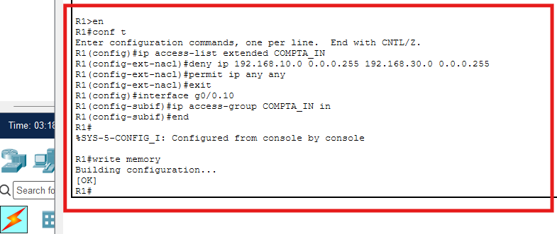

## Tests de validation

| Test | Résultat |
|---|---|
| PC Comptabilité vers le serveur interne (192.168.20.10) | ✅ Réussi |
| PC Comptabilité vers un PC de la Direction | ❌ Bloqué par l'ACL |
| PC Direction vers un PC de la Comptabilité | ❌ Bloqué par l'ACL |
| PC Informatique vers la Direction et la Comptabilité | ✅ Réussi |
| Navigateur : `http://entreprise.local` | ✅ Page affichée |
| `nslookup entreprise.local` | ✅ Renvoie 192.168.20.10 |
| `ping 8.8.8.8` depuis un PC | ✅ Réussi, 0 % de perte (NAT) |

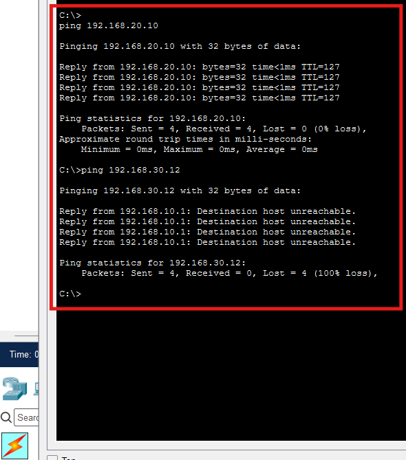

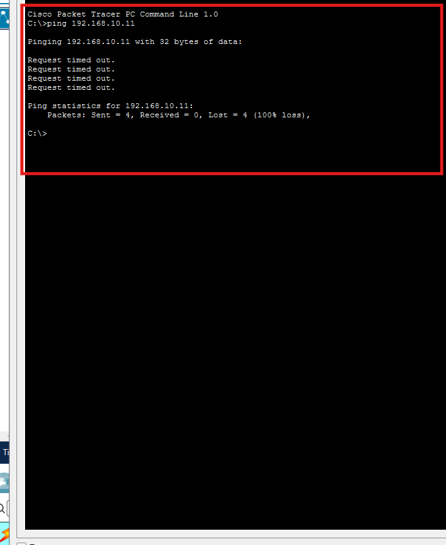

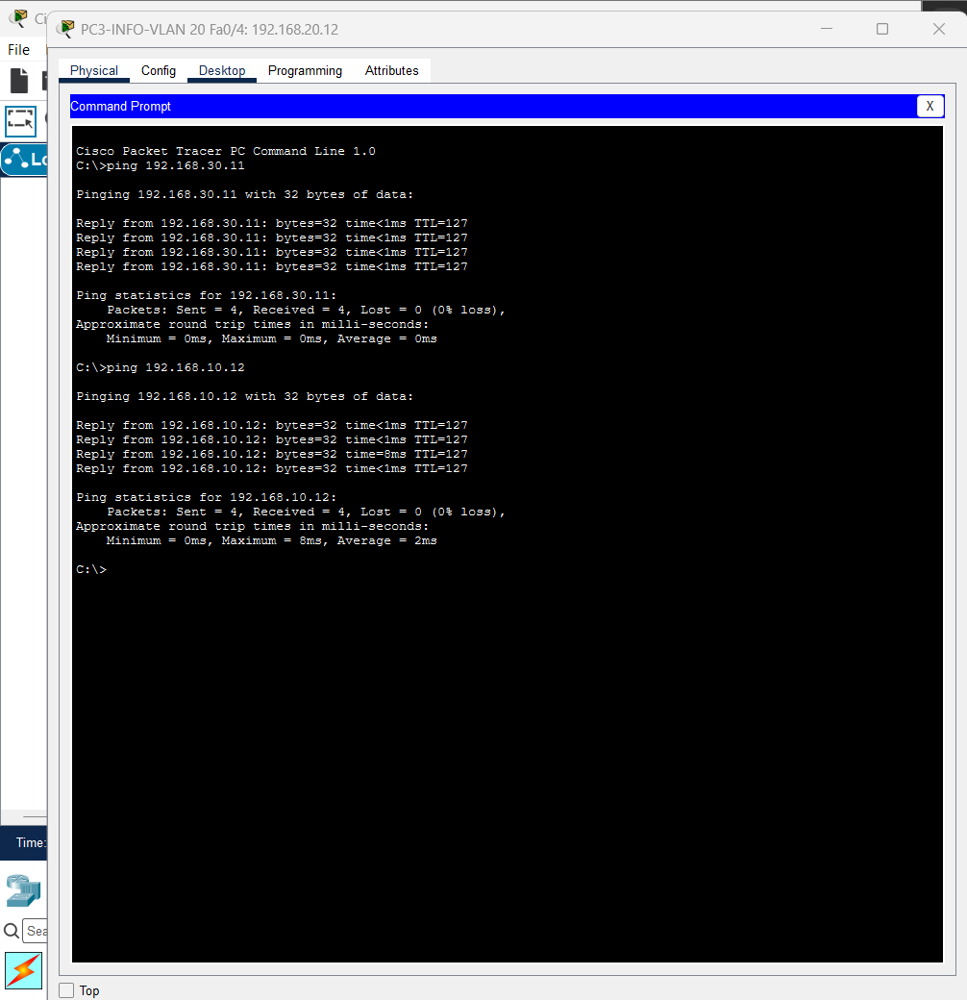

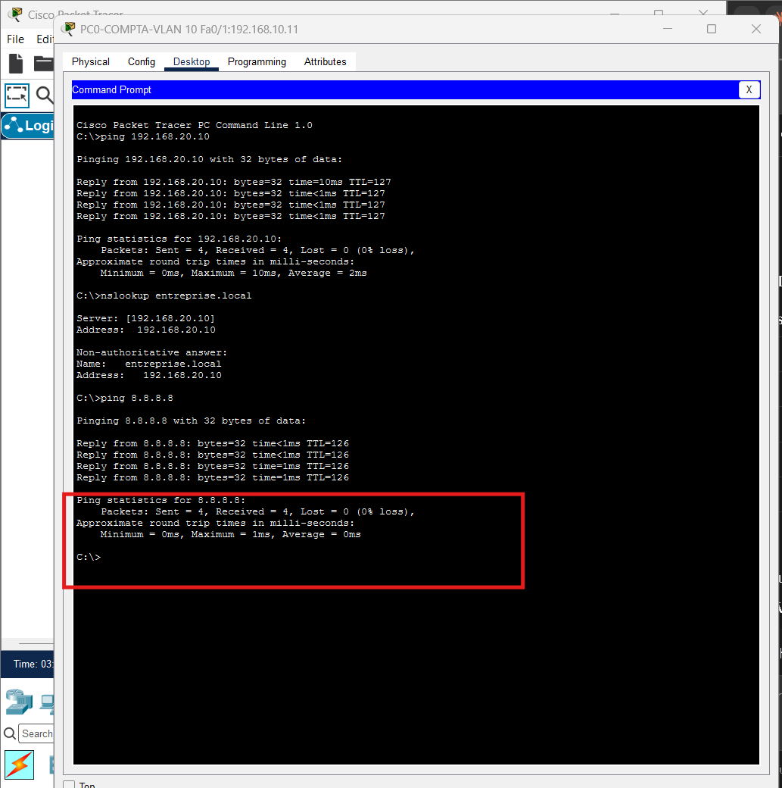

### Vérifications sur les équipements

| | |
|---|---|
| `show access-list` sur R1 : la règle `deny` compte 12 correspondances | 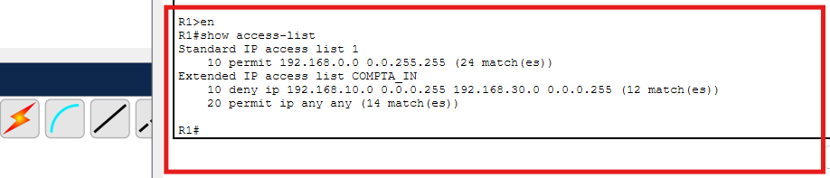 |
| `show ip nat translations` sur R1 | 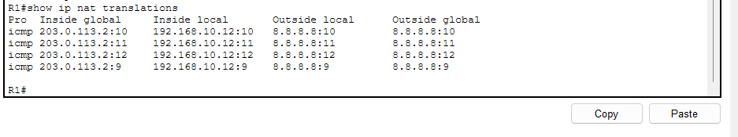 |
| `show ip dhcp binding` sur R1 : une adresse par PC | 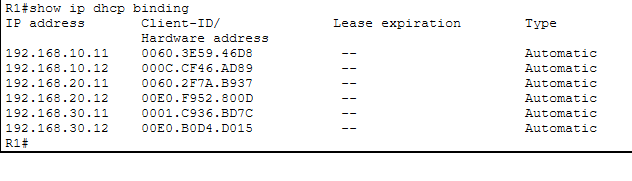 |

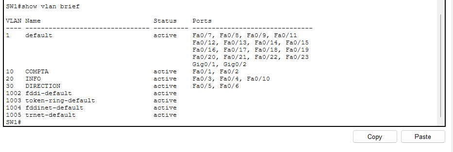

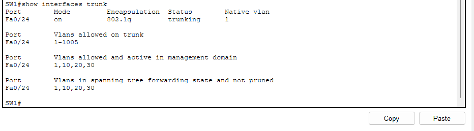

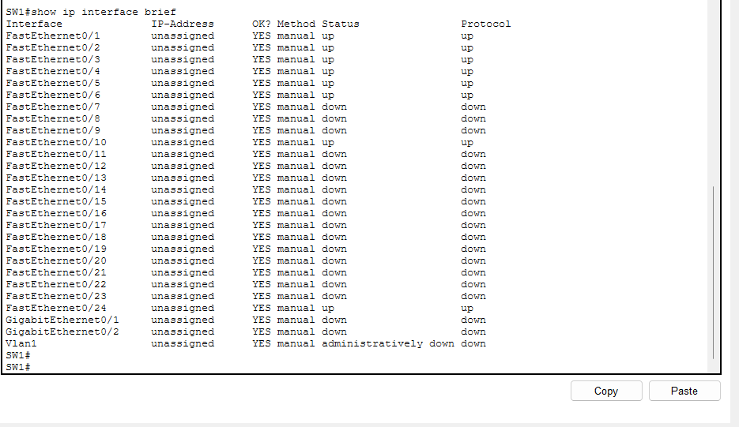

## Compétences mises en oeuvre

- Segmentation par VLAN et trunk 802.1Q
- Routage inter-VLAN (router-on-a-stick)
- Services DHCP, DNS et HTTP
- NAT/PAT vers un accès Internet simulé
- Filtrage par ACL étendue
- Vérification et dépannage avec les commandes `show` et les tests de connectivité

## Structure du dépôt

```
.
├── README.md
├── configs/          Configurations de SW1, R1 et FAI
├── docs/             Rapport complet du projet (PDF)
├── images/           Captures d'écran des configurations et des tests
└── packet-tracer/    Fichier du projet (.pkt), à ouvrir avec Cisco Packet Tracer
```

Le rapport complet est disponible dans [`docs/Rapport_reseaux.pdf`](docs/Rapport_reseaux.pdf).

## Pour aller plus loin

- Serveur Windows avec Active Directory pour gérer les comptes utilisateurs
- Second switch avec redondance (STP)
- Sécurité de port (port-security) et accès d'administration par SSH
- Mots de passe chiffrés (`enable secret`, `service password-encryption`)

## Auteur

**ANDRIAMANANTENA Jean Angelin** - [github.com/jeanAngelin](https://github.com/jeanAngelin)